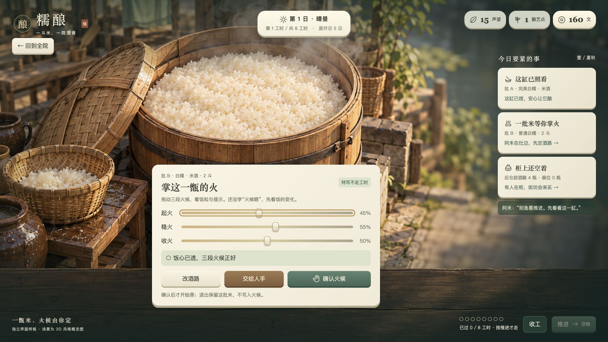

# 糯酿 · 3D 界面效果设计

2026-10-01 · 基于游戏文档 0.2  
方向：**水乡微光 · 暖坛。米的变化看得见，酒坊的活接得上。**

[直接打开界面样板](直接打开.html) · [查看全部画面](效果总览.html) · [风格规范](风格规范.md) · [检查记录](验收/验收记录.md)

## 1. 这次做成什么

一份可直接双击打开的独立界面样板，配三张专门为糯酿制作的场景图：酒坊全院、蒸甑特写、看缸特写。样板可以完成首日的搅缸、选择酒路、调三段火候、上架、定价、成交与三行日结；六页账册、人手换岗、十一处工位查看、灯色和可读性设置也能操作。

场景是生成的 **3D 风格概念图**，不是可旋转模型。图中的米饭、坛、人物和灯具不会逐件随操作改变；名牌、提醒、火候提示、展位、库存与账页会实际更新。灯色是同一张图的色调预览，饭床异常是局部效果示意。真正的镜头移动、模型状态、人物走路与米饭形态，需要在正式游戏制作时落地。

本次交付用于确定画面和操作形式，不替代正式游戏。它不读取正式存档，不模拟完整 28 日、完整种植、全部成品生产、批购、升级或家具购买。正式规则仍由 `docs/00`–`28` 决定。

## 2. 从参考里取什么

实际浏览了用户已经打开的 [Pinterest 模拟经营搜索页](https://www.pinterest.com/search/pins/?q=%E6%B8%B8%E6%88%8F%20%E6%A8%A1%E6%8B%9F%E7%BB%8F%E8%90%A5)，并打开三个详情：

| 参考 | 看见的形式 | 用到糯酿的部分 |
| --- | --- | --- |
| [经营游戏主画面](https://www.pinterest.com/pin/7740630606841371/) | 资源信息在上，场景居中，有厚度的操作入口围绕场景 | 工时、天气、文在上缘，院子占画面主体 |
| [ux flow](https://www.pinterest.com/pin/2111131073678122/) | 经营主画面连接菜单、图鉴、管理与结算页 | 今日、米与酒、酒谱、人手、本季、器物共用一本账册 |
| [多工位经营参考](https://www.pinterest.com/pin/66780006971465095/) | 多处工位共存，状态提醒贴近相关建筑 | 哪缸该搅、哪批在等、哪个站缺人，都对应具体地点 |

Pinterest 图片仅用于观察，没有复制为交付素材；图的作者和具体游戏名称没有逐一核实，不据此判断来源、授权或实际玩法。

另读了【粥霸天】的设计方案、参考记录和验收画面。沿用它的**场景居中、木牌贴工位、厚瓷按钮、暖纸面板、近景操作与收工账页**。糯酿的区别来自原有策划：一进长院、三块田、米到酒的多站并行、主动推进时间，以及半页账册。不会把它做成有点单耐心条和盛碗按钮的粥店。

## 3. 酒坊全院

从南侧河埠向北看，斜俯视、切掉妨碍观察的外墙。上方三块田，中间木廊连接各站；东侧摊席与曲案，西侧发酵房和酒窖，南侧前柜朝河埠开口。水、粉墙与竹篱围住院子，不增加开放世界入口。

概念图用于定材料与气氛；正式模型应严格按 `02` 的邻接关系与 `04` 的当级容量制作。图中桌、席与瓶坛的示意数量不充当运行中的库存或容量，界面以账册与展位记录为准。

| 位置 | 常驻内容 | 处理方式 |
| --- | --- | --- |
| 左上 | 糯酿、简短坊语 | 宋体感标题、朱色小印，留白 |
| 上中 | 第几日、晴雨、当前工时、距圩日 | 厚瓷小牌，一直可见 |
| 右上 | 文、声望、酿艺点 | 三个安静的小牌；不出现首发关闭的泉华 |
| 左侧 | 酒坊、账册、酒谱、器物、设置 | 四个主要入口，设置小一号 |
| 工位上方 | 站名、批次、当前状态 | 暖纸木牌；离开这站时随批次换位置 |
| 右侧 | 最要紧的缸、待蒸批、前柜 | 首日保留三件事，后续只放真正需要决定的事项 |
| 右下 | 工时进度、推进、收工 | 清楚写“按推进才走”，不画现实倒计时 |

正式全院画面至少同时看清田、廊、柜三站。屋顶只遮住不参与操作的边缘；工位特写中可以隐藏就近屋顶。

## 4. 蒸甑：让米饭成为主角

先问这批做甜酒酿还是米酒，再显示起火、稳火、收火三条。右边仍可看到那缸酒和柜上的提醒，下方保留确认与返回。不是实时躲避倒计时，而是观察饭、调整、确认的一次决定。

| 状态 | 画面与提示 | 操作 |
| --- | --- | --- |
| 尚未选酒路 | 窗口只呈现两条已开放酒路 | 先选，再掌火 |
| 未学火候眼 | 不画合适范围，饭的变化与文字仍显示 | 拖动或方向键，每步 0.05 |
| 已学火候眼 | 滑杆后显示青色范围 | 设置里的开关仅用于查看这层样式 |
| 合适 | 饭粒合拢、软亮；“○ 饭心已透，三段火候正好” | 确认后获得亲手加成 |
| 夹生 | 颗粒缝隙、菱形图标与文字 | 可以修改；确认后记录夹生 |
| 焦糊 | 暗硬边、块状图标与文字 | 可以修改；确认后记录焦糊 |
| 收火不足 | 表面回黏、波纹图标与文字 | 不记夹生或焦糊，但不获亲手加成 |
| 无人烧火 | 确认与交给人手都不可用 | 提示先派人到蒸甑 |

白糯中心值 0.45 / 0.55 / 0.50，三条容差 ±0.12，均来自 `04`。确认开始 1 工时蒸饭；退出不确认，不耗工时、不记瑕疵。亲手合格 +2 酿艺点，出带 +1；交给人手无亲手加成。不能把炉火好坏写成现实温度或真实酿酒教程。

## 5. 看缸：一个动作就够

深褐缸与白米发酵状态清楚可见，木环和固定图标标出窗口。只有“搅一下”和返回；不增加长搅拌小游戏。点过后按钮变成“已搅过”，不能重复领点。

开局批 A 已发酵 2.5 / 6 工时，窗口剩 1 工时。错过后仍继续发酵，账册留下“误了搅缸”；成色与五味按原规则受影响。提醒的亮环不靠闪烁，静音、减少动效时也能看见字。正式镜头短推近即可；样板使用独立近景供看材质与按钮位置。

## 6. 前柜：知道为什么卖了

四个展位和后仓分开。点空展位或“上架一瓶”放酒，点已摆的瓶收回。正式游戏也支持拖放；样板用点击演示同一件酒只在一处的关系。

让利、平价、讲究并排，只在上架时问价格。开局甜酒酿成色 42、同风格氛围倍率 1.10，对应 12 / 15 / 18 文。街坊接受让利和平价；讲究档会显示“标价不合”，不把离开写成随机失败。

样板固定两位街坊在第 2、4 工时到柜，用来检查主流程。正式客人由原文档的种子和客群生成，不照抄这两个时刻或名字。没人站柜时先等 1 工时，再检查能否成交。上架、回收、改价本身不走时间。

正式后续页面补足：成品列表中的“留给批购”状态、成色与酒路不足的原因、茶客 / 行商 / 圩日游客的两项要求。原型中不把这些未来状态伪装成已经运行的完整销售系统。

## 7. 半页账册与十一工位

账册在画面右侧展开，1920 宽时约 510 像素，1280 宽时约 445 像素。它替换右侧提醒位置，仍保留左侧酒坊可见；长内容只在账页内滚动。

| 页 | 内容与形式 |
| --- | --- |
| 今日 | 三日预报、照料动词、两批所在站、剩余工时向上取整、客人记录、工位定位 |
| 米与酒 | 米、曲、后仓与展位分栏；不把原料品相与酒成色混成一个数 |
| 酒谱 | 酒名、品相印章、酒路、成色；香甜醇净韵五条清楚的短条 |
| 人手 | 阿禾、阿青、当前站、准备去的站；文字说明下个整点生效 |
| 本季 | 三件自定目标；下一等级的钱与声望条件 |
| 器物 | 首发风格、灯色预览、摆放边界；不另定文档仍待定的家具价格 |

十一处工位统一使用“站名 → 正在做什么 → 为什么在等 → 下一步”的小面板。图上的五个重点木牌保持全院简洁，其余可从今日页定位。

| 工位 | 首要读法与操作 |
| --- | --- |
| 水田 | 三块田的阶段；今日照料动词；能收时指向派工 |
| 浸缸 | 在水里的米；待组批或剩余工时 |
| 蒸甑 | 等米 / 缺人 / 待掌火 / 已定火候 |
| 摊席 | 露天与檐下可辨；凉透才能顺畅转站 |
| 曲案 | 缺人、缺曲分别说明；没有亲手拌曲滑杆 |
| 发酵房 | 缸对应批次；窗口、已搅、误了搅各有字与图标 |
| 压榨 | 缺人或开始压榨；遇败酿必须改去向 |
| 澄清槽 | 只给清酒；提前离开明确提示“澄清不足” |
| 酒窖 | 窖位按批计；短陈一道绳，长陈两道绳 |
| 调配案 | 桂花酿到这里才加桂花；没桂花则等 |
| 前柜 | 展位、标价、站柜人手、成交 / 离开原因 |

## 8. 日结只留三行

田、酒、柜各一行。先说今天的变化，再给收入、开销、余钱。未完成的批次继续写所在站，不编造出酒。收工确认会列出可能错过的窗口与客人；查看账页不重复扣开销。

实测的示例：160 文开局，搅缸 +1 酿艺点，亲手合格蒸饭 +2，平价卖两瓶收入 30，开销 8，余钱 **182 文**，声望 **17**，酿艺点 **3**，后仓还剩 **2 瓶**。可以保存当天账页，原型结束后可回看或重新体验。

## 9. 尚未在样板中运行、但已规定的界面

这些遵循正式文档，在接入正式游戏时使用同一套按钮与半页账册，不另开陌生的界面风格。

| 情形 | 界面安排 | 约束 |
| --- | --- | --- |
| 老周卖米 | 河埠木牌 + 今日报价卡，品种、品相、斗数、总价、买下 | 第 2 日起；不出现首日报价 |
| 批购 | 第 3 日起挂木牌，酒路、件数、最低成色、交期、定金；再选接 / 不接 | 库存标“留给批购”，避免与上架重用 |
| 败酿 | 布盖坛、小提示：“这批成色不够，改做什么？”；醋 / 料酒 / 饲料三个等宽按钮 | 在规定判定口拦截；不做红屏、不销毁，不暗示首发能卖给客人 |
| 后仓满 | 出口工位牌写“后仓满了，成品先留在这里”；按钮指向米与酒页 | 不偷放进超容量库存，不能接下一批 |
| 装瓶与命名 | 两种已解锁外形、朱 / 石青 / 月白封签、1–8 字酒名、确认 | 封签不代表成色；名字不加价；空名用酒路名 |
| 家具摆放 | 保留场景，器物页拖到格子；合格处有轮廓与“可放”，通路写“留给走路” | 禁占田、工位操作点、展位、河埠通道；当前日客流不即时重算 |
| 升级 | 本季页展示门槛、缺项与收工支付按钮 | 次日开坊生效；2 级清酒、3 级桂花、4 级扩容 |
| 常驻委托 | 人手页挂一件短委托，后仓交酒，奖励写声望与酿艺点 | 首次成交后才出阿青委托；不发现金 |

## 10. 材料、尺寸与动效

立体感分三层：场景的陶木体积、名牌与纸面的浅层投影、按钮的实体底边。所有按钮顶面略亮，底边略深，按下下沉约 3 像素。青釉代表确认 / 推进，木面代表亲手动作，米白瓷面代表查看 / 返回。完整色值、字体、圆角与组件状态见 [风格规范](风格规范.md)。

正文基础 18 像素，放大档 20；标题宋体感、说明黑体感，使用本机中文字体。数值是本次主动制定的规格，不宣称从 Pinterest 精确采样。

只有该搅的木牌有慢呼吸边线；按钮按下、短提示出现才动。减少动效会关闭过渡与呼吸光，仍保留文字和边框。警告用棕红和明确形状，成色、品相、瑕疵不只靠颜色。

## 11. 窗口与落地顺序

电脑优先，已检查 1920×1080 和 1280×720。小窗口不把正文缩得很小，而是让账页内部滚动，保持工位操作与右侧提醒、底部推进不重叠。窄屏提供便于看方案的排布，不将其宣称为首发移动版。

正式制作顺序：酒坊与三块田的全院画面 → 工位名牌与推进 → 蒸甑特写 → 看缸 → 前柜 → 六页账册 → 收工与恢复进度。图像中的细木纹、饭粒密度和釉面高光是目标观感，正式模型按 `17` 的预算简化，不能把概念图当作已完成的三维资产。

检查结果与边界都在 [验收记录](验收/验收记录.md)。原有策划文档和【粥霸天】文件没有被改动。
